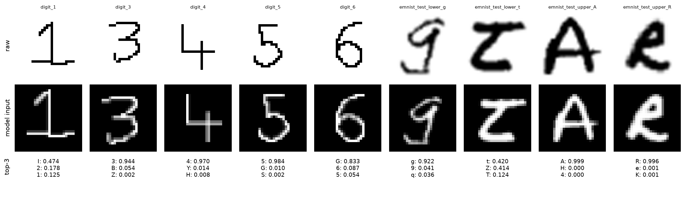

# Handwritten Character Recognition

I built this to read handwritten digits and letters from image files with Keras. It started as a tutorial MLP on MNIST and grew into a small OCR project that recognises all 94 printable keyboard characters (capital letters, small letters, digits and 32 common symbols) and compares four model families.



## The notebook

[`notebooks/OCR_Keras_TF.ipynb`](notebooks/OCR_Keras_TF.ipynb) is the write-up: data, preprocessing, the four models, an epoch sweep, a hidden-layer sweep, a three-seed model comparison, the final model, error analysis and a live demo. It is executed, so the outputs are saved in the file. Every number in its text is read from `experiments/results/*.json`, not typed in.

Everything here ran on the **CPU** (TensorFlow 2.20 has no native-Windows GPU build). Sweeps therefore use training subsets (80k and 200k images); only the final model trains on all 742,742 images.

### Data (`data/`, git-ignored except its README)

| Source | Used for |
| --- | --- |
| EMNIST ByClass | handwritten 0-9, A-Z, a-z (62 classes, capital and small kept apart) |
| HASYv2 | handwritten symbols (17 of the 32 keyboard symbols) |
| Rendered system fonts | printed glyphs for all 94 classes, including the 15 symbols HASYv2 lacks |

Test font files and HASYv2 test writers never appear in training, and exact duplicates between splits were removed. See [`data/README.md`](data/README.md) for provenance, licences and per-class counts.

Getting the data: `load_unified()` downloads the EMNIST archive from NIST by itself on first use (about 560 MB, into `data/raw/emnist/`). HASYv2 is **not** downloaded by any code: get `HASYv2.tar.bz2` from <https://zenodo.org/records/259444> and put it in `data/raw/hasy/`. The printed glyphs come from the Windows fonts folder (`C:\Windows\Fonts`), so on a machine with different fonts you get a different dataset and different numbers. The first call builds and caches `data/processed/unified.npz` (about 750 MB).

### Results

Four families, best configuration of each, three seeds, 200k training images, 12 epochs (mean validation accuracy): ResNet-style CNN 84.5 %, plain CNN 84.1 %, CNN + BiLSTM 82.7 %, MLP 82.6 %. The ResNet-vs-CNN gap (0.4 points) is smaller than the seed-to-seed spread (0.6), so treat them as tied; the ResNet has about 30 % fewer parameters.

The winner, trained on the full training set (10 epochs, 4 residual blocks), scores **84.7 % on the held-out test set** (strict, exact character). Merging look-alike characters (`c`/`C`, `o`/`O`/`0`, `l`/`I`/`1`/`|`, ...) gives 94.5 %, and 63.6 % of all errors are such pairs.

| Test subset | Accuracy |
| --- | ---: |
| Digits | 95.3 % |
| Capital letters | 80.8 % |
| Small letters | 67.6 % |
| Symbols | 88.9 % |
| EMNIST (handwritten) | 85.4 % |
| HASYv2 symbols (handwritten, only 165 images, 95 % interval 80.6-91.0 %) | 86.7 % |
| Fonts (printed; slightly optimistic, see limitations) | 73.3 % |

### Limitations

- 15 symbols (`! @ ( ) _ = ; : ' " , . ? ^` and the backtick) have only printed training and test data, so their accuracy says nothing about handwriting.
- The handwritten-symbol test set is tiny (165 images) because one aggregate HASYv2 writer id, about 89 % of the handwritten symbol samples, must stay in training. For several of the 17 covered symbols (for example `+ - < >`) printed fonts are still most of the training images.
- The font split is by file, so bold/italic siblings of a training font (`arial.ttf` is in training, `arialbd.ttf` and `ariali.ttf` are test fonts) can land in the test set. The printed-font accuracy is therefore a little optimistic. About 3 % of the printed training images are almost blank after augmentation.
- EMNIST has no writer ids, so its validation split can share writers with its training split.
- After the EMNIST-style crop and rescale, capital and small `c k m o p s u v w x y z`, `l I 1 |` and `. , '` look the same; a single-glyph classifier cannot resolve them without context. The 94.5 % merged accuracy merges the letters and `l I 1 |` only, not the marks and not `f`/`F`.
- Printed text is read worse than handwriting (73 %), and the line demo misreads `r` as `[` or `H` even in a font it trained on.
- The final model trained for 10 epochs to save CPU time; the epoch sweep says more epochs would still help a little. ResNet validation curves are noisy in short runs.

### Reproduce

```bash
pip install -r requirements-dev.txt
python scripts/run_experiments.py            # resumable; cached under experiments/results/ (delete it if you change hcr/zoo.py or the data)
python scripts/bn_momentum_check.py          # re-creates experiments/bn_momentum_check.json quoted in the notebook
python scripts/build_notebook.py             # regenerates the notebook source
python -m nbconvert --to notebook --execute --inplace notebooks/OCR_Keras_TF.ipynb
```

## Single-character command line

The original per-dataset tools still work. Preprocessing composites transparent PNGs over white and inverts dark-on-light images, crops to the ink, scales the longer side to 20 px and centres it by centre of mass in a 28x28 frame, the same way MNIST was made.

```bash
python -m hcr.predict samples/emnist_test_upper_A.png                  # EMNIST balanced model
python -m hcr.predict samples/digit_*.png --model models/mnist_cnn.keras
python -m hcr.predict samples/digit_1.png --model models/ocr_best.keras # the 94-class winner
python -m hcr.train --dataset emnist-balanced --arch cnn --epochs 15
```

Earlier single-dataset baselines (CPU, seed 42, up to 15 epochs, official test split):

| Dataset | Classes | MLP | CNN |
| --- | ---: | ---: | ---: |
| MNIST | 10 | 98.09 % | 99.39 % |
| EMNIST balanced | 47 | 83.84 % | 88.46 % |
| EMNIST letters | 26 | not trained | 94.16 % |

The `keyboard-symbols` dataset in `hcr/symbols.py` draws each glyph in one fixed font, so its train and test images are identical and its 100 % score is not evidence of handwriting recognition. It is kept only for the old command line; the notebook uses the font-disjoint split instead.

Tests use synthetic data only apart from one `slow` integration test that needs the real data: `pytest -m "not slow"` skips it. CI runs the tests on every pull request.
